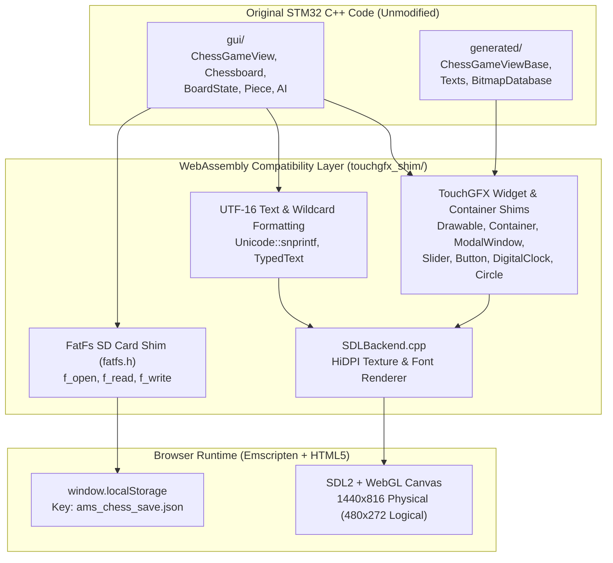
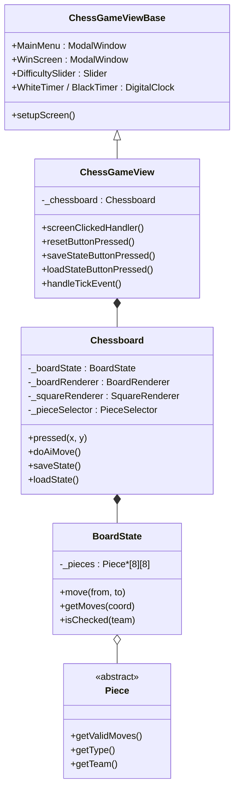

# ♟️ AMS Chess — WebAssembly Port

A WebAssembly port of the STM32 TouchGFX chess game originally built for the Applied Microcontroller Systems (AMS) course at Aarhus University ([`team-muppet/TouchGFX-Chess`](https://github.com/team-muppet/TouchGFX-Chess)).

Instead of rewriting the game in JavaScript, this port compiles the original C++17 game code and TouchGFX Designer UI layouts directly to WebAssembly with Emscripten (`em++`), backed by a lightweight SDL2 implementation of the TouchGFX API.

---

## 🚀 Quick Start

### Run the Prebuilt Bundle
Precompiled files are included in `dist/`. Serve the `dist/` folder over any local HTTP server:

```bash
# Using Python
python -m http.server 8080 --directory dist

# Or using Node.js
npx serve dist -l 8080
```

Then open `http://localhost:8080/index.html` in a browser.

### Build from Source
Requires the [Emscripten SDK](https://emscripten.org/docs/getting_started/downloads.html) (`em++` in your `PATH`). Emscripten automatically downloads and caches the `SDL2`, `SDL2_image`, and `SDL2_ttf` ports on first build.

```powershell
# Windows
.\build.bat
```

```bash
# Linux / macOS
make
```

Build outputs are written to `dist/index.html`, `dist/index.js`, `dist/index.wasm`, and `dist/index.data`.

---

## 🏗️ Architecture

The port keeps the original `gui/` and `generated/` C++ sources intact and replaces the proprietary STM32 TouchGFX runtime and FatFs SD-card driver with an SDL2 + WebGL shim layer.



### High-DPI Rendering (`480×272` Logical → `1440×816` Physical)
The original STM32 hardware uses a `480×272` screen (`272×272` chessboard with `34×34` pixel squares, plus a `208×272` sidebar).

To render sharply on modern displays without changing hardcoded coordinates in `ChessGameViewBase.cpp` or `Chessboard.cpp`:
1. `src/main_wasm.cpp` creates a **3× physical canvas (`1440×816`)** with `SDL_WINDOW_ALLOW_HIGHDPI` and sets `SDL_RenderSetLogicalSize(renderer, 480, 272)`.
2. `SDLBackend.cpp` reports the original `1×` dimensions to TouchGFX widgets so layout math stays in `480×272`, while loading **3×/4× high-resolution PNG textures** from `assets/images/`.
3. `SDL_ttf` rasterizes `assets/fonts/verdana.ttf` at **3× physical font sizes** (`30px`, `36px`, `60px`, `120px` instead of `10px`, `12px`, `20px`, `40px`) and draws them into logical coordinates via `SDL_RenderCopyF`.

---

## 📁 Directory Structure

```text
ams-chess-wasm/
├── Makefile / build.bat     # Emscripten build scripts
├── shell.html               # Responsive dark-themed HTML5 shell
├── dist/                    # Prebuilt WebAssembly bundle (index.html, .js, .wasm, .data)
├── src/
│   └── main_wasm.cpp        # SDL2 init, 60 FPS main loop, mouse -> ClickEvent bridge
├── touchgfx_shim/
│   ├── include/             # TouchGFX API headers (touchgfx/*, mvp/*, common/*, fatfs.h)
│   └── src/                 # SDLBackend.cpp, TouchGFXCore.cpp, Unicode.cpp
├── gui/                     # Original game logic & UI views from TouchGFX-Chess
├── generated/               # TouchGFX Designer generated screen layouts, texts, and bitmap IDs
├── assets/
│   ├── fonts/verdana.ttf    # TrueType font used by SDL_ttf
│   └── images/              # Raw 3x/4x PNG textures packed into dist/index.data
└── rapidjson/               # Header-only JSON library used for game save/load
```

---

## 🧠 Game Logic Overview



- **Game Modes**: Local 2-player (**Multiplayer**) or vs. computer (**Singleplayer**) with difficulty selectable from `1` to `10` on the main menu slider.
- **Timers & Turn Indicator**: `ChessGameView::handleTickEvent` ticks at 60 Hz and updates `WhiteTimer` / `BlackTimer` every 60 ticks (1 second).
- **Save & Load**: Clicking the floppy disk icon serializes the board state, move history, timers, and AI settings to JSON via RapidJSON. On STM32 this wrote to `0:/save.json` on an SD card; in WebAssembly, `touchgfx_shim/include/fatfs.h` stores the JSON string in `localStorage["ams_chess_save.json"]`.

---

## 🤖 Notes for Developers & AI Agents

If you are modifying or extending this codebase, keep these invariants in mind:

1. **Keep C++ Coordinates in `480×272` Logical Space**
   - Never multiply widget positions or sizes by 3 in `gui/` or `generated/`.
   - Board click detection in `ChessGameView::screenClickedHandler` checks `x < 272` and divides `(x, y)` by `34` in `Chessboard::pxToCoord` to get board squares `0..7`.

2. **How Bitmaps Work (`BitmapDatabase.hpp` → `SDLBackend.cpp`)**
   - We do **not** compile the RGB565/ARGB8888 byte arrays in `generated/images/src/*.cpp`.
   - Instead, `s_bitmapAssets` in `touchgfx_shim/src/SDLBackend.cpp` maps each `BITMAP_*_ID` constant to a `.png` path in `assets/images/` along with its **logical** `1×` width and height.
   - The underlying `.png` file on disk can have any higher physical resolution (e.g. 3× or 4×). `SDLBackend::drawBitmap` and `SDLBackend::drawBitmapClipped` automatically scale from the texture's physical pixel dimensions to the widget's logical rectangle.

3. **TouchGFX Hit-Testing & `touchable` Flags**
   - `ChessGameView` attaches a `ClickListener` to `Background` (the bottom-most `Image` covering `0,0` to `480,272`) to capture board clicks.
   - Overlay containers added on top of `Background` (`_chessboard`, `DummyBackground`, `_squareRenderer`, `_pieceSelector`, `_boardRenderer`) must keep `touchable = false` (the default for `Container` and `Image`) so clicks pass through to `Background`.
   - `ModalWindow` (`MainMenu` and `WinScreen`) sets `touchable = true` so that when a modal is visible, clicks outside its buttons are swallowed and do not trigger moves on the board behind it.

4. **UTF-16 Strings (`touchgfx::Unicode::UnicodeChar`)**
   - TouchGFX represents strings as `uint16_t` arrays generated in `generated/texts/src/LanguageGb.cpp`.
   - When calling `Unicode::snprintf`, any `%s` argument must be a `const UnicodeChar*` (use `Unicode::strncpy` to convert a `const char*` first).

5. **Repackaging Assets**
   - `build.bat` and `Makefile` pass `--preload-file assets@/assets` to `em++`, which bundles `assets/` into `dist/index.data`. Any change to files in `assets/` requires running the build script to regenerate `dist/index.data`.

---

## 📜 Credits & License

- **Original STM32 TouchGFX Game**: Anders Lillelund Clausen & Mathias Gorm Petersen ([`team-muppet/TouchGFX-Chess`](https://github.com/team-muppet/TouchGFX-Chess) · [Project Demo Video](https://www.youtube.com/watch?v=8L-S7ZYVGmU))
- **License**: [MIT](LICENSE)
